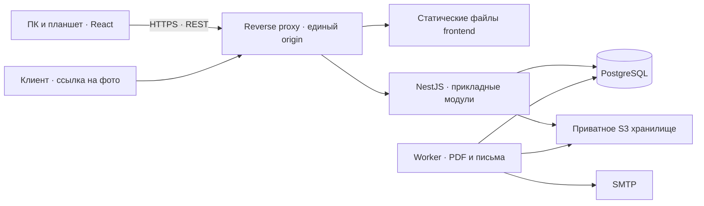

# Архитектура CRM проката автомобилей

> Уточнение пользователя от 17 ноября 2026: бронь хранит плановую стоимость и её историю. Приём оплаты, залога и зачёт в оплату разрешаются только при оформлении договора и фактической выдаче машины. Выдача пока не реализована, поэтому эти команды заблокированы в UI и API. Журнал оплат показывает только фактические поступления и возвраты. Предыдущие описания оплаты непосредственно по брони ниже исторические и заменены этим правилом. [Исправление и проверки](finance-issuance-2026-11-17.md).

14 ноября 2026 года пользователь принял этап 4 — бронирования, расписание и шахматку, включая согласованные доработки интерфейса и конфликтов. Этапы 1–4 завершены и приняты. [Результат этапа 4](stage-4.md). Этап 5 — финансовое ядро и оплаты — реализован по последующей команде пользователя 15 ноября 2026 года, проверен и принят пользователем 18 ноября 2026 года с учётом исправления от 17 ноября: [результат](stage-5.md). Этапы 6–11 не начаты. 86 реальных автомобилей уже импортированы по отдельному разрешению: [результат](fleet-import-2026-11-14.md).

Уточнение 13 ноября: при досрочном возврате расчётный лимит пробега = суточный пакет × max(1, полные использованные сутки). Раньше первых суток сохраняется один пакет без добавления стоимости суток. Явный индивидуальный лимит, включая 0 км, имеет приоритет; исходная история не переписывается.

13 ноября 2026: этап 3 завершён и принят пользователем — серверный Pricing, `/pricing` и самостоятельные неизменяемые расчётные снимки. Подтверждение не проводит бронь, фактические использования или деньги. Прайс в версионируемом config, без конструктора тарифов. [Итог этапа 3](stage-3.md) уточняет границу с будущими booking_terms и Finance. Этап 4 уже принят; [этап 5](stage-5.md) реализован по последующей команде пользователя; отчёт описывает фактические таблицы, API и ограничения финансов. Ниже описана полная целевая архитектура, а не перечень существующих модулей.

Клиенты, автомобили, справочники, обслуживание и общий polling реализованы в этапе 2, принятом 12 ноября; [отчёт](stage-2.md). Упоминания ниже об отсутствии этих бизнес-модулей/polling относятся к состоянию до этапа 2. Остальная целевая архитектура после принятого этапа 3 остаётся проектом.

Дата редакции: 12 ноября 2026 года. Основание: ТЗ v1.1 от 11 ноября 2026 года и последующие согласованные ответы пользователя. Эта редакция заменяет архитектуру по v0.7.

Статус: проект для согласования. Этот документ описывает целевую архитектуру; он не означает разрешения на реализацию следующих этапов. Бизнес-правила читаются с согласованными уточнениями Q1–Q17, имеющими приоритет над исходным ТЗ и примерами Excel.

## 1. Решение и границы

Предлагается модульный монолит: браузерное React-приложение, NestJS API, PostgreSQL и приватное файловое хранилище. Фоновые задания выполняет отдельный процесс из той же кодовой базы. Одна компания, 20–100 автомобилей, ориентировочно до 10 одновременно работающих сотрудников. Все бизнес-операции подтверждает сервер.

Завершён этап 1; его завершение подтверждено пользователем 12 ноября 2026 года: оболочка UI, авторизация/роли/сотрудники, сессии и инфраструктура команд. Актуальный объём и проверки — [этап 1](stage-1.md). Остальные предметные модули, файловое хранилище и worker ниже остаются проектом.

Не закладываются филиалы, мультитенантность, offline-first, импорт Excel, публичное бронирование и электронная подпись. В P0 входят фактические расходы, касса, залоговый фонд, инкассации, сверки, штрафы, долги и экспорт журнала в Excel. P1 — расширенная аналитика. Redis и отдельный брокер сообщений пока не нужны.



На локальном этапе frontend и API работают отдельными процессами, Vite проксирует `/api`, PostgreSQL доступна на loopback. Для рабочего размещения proxy раздаёт собранный frontend и направляет `/api` в API; БД не публикуется наружу. Размещение данных и резервных копий в РФ — требование ТЗ, конкретная инфраструктура согласуется перед пилотом.

## 2. Технологии и их назначение

| Область               | Проектное решение                                                                                   |
| --------------------- | --------------------------------------------------------------------------------------------------- |
| Frontend              | Сохранить React, TypeScript, Vite и Ant Design из каркаса                                           |
| Маршрутизация         | Предлагается React Router; страницы загружаются по мере перехода                                    |
| Серверные данные      | TanStack Query: загрузка, кэш в памяти, повторное чтение после изменений                            |
| Формы                 | React Hook Form + Zod; окончательная проверка всегда в API                                          |
| Локальное состояние   | Zustand только для состояния интерфейса; формы используют собственное состояние                     |
| Backend               | NestJS, REST `/api/v1`, OpenAPI, генерируемый клиент                                                |
| База                  | PostgreSQL 17, Drizzle, SQL-миграции для ограничений диапазонов                                     |
| Обновление экранов P0 | Согласован автоматический опрос раз в 5 секунд для активного экрана; SSE отложен и не входит в MVP  |
| Фоновые задания       | PostgreSQL outbox/jobs и worker той же версии, что API                                              |
| Файлы                 | Приватное S3-compatible хранилище, доступ через проверяемые сервером маршруты                       |
| PDF                   | Предлагается HTML-шаблон → headless Chromium в worker; обязательные русские шрифты и версия шаблона |
| Проверки              | Unit — Vitest; integration — реальная PostgreSQL и Supertest; E2E — Playwright                      |

Новые библиотеки устанавливаются при реализации соответствующего этапа, после отдельного согласования. Наличие технологии в таблице не означает её наличия в текущем каркасе.

## 3. Backend и владельцы данных

| Модуль         | Ответственность и принадлежащие ему данные                                                                                                                                          |
| -------------- | ----------------------------------------------------------------------------------------------------------------------------------------------------------------------------------- |
| Identity       | Пользователи с ФИО/логином, роли admin/manager, сессии; первый admin при развёртывании, новые сотрудники из /users — manager                                                        |
| Fleet          | Марки, модели, машины, группы аналогов, история показаний одометра                                                                                                                  |
| Customers      | Физлица, организации, реквизиты, личные документы, заметки и ручная блокировка новых броней и выдачи по существующим; независимые вычисляемые теги                                  |
| Pricing        | Тарифные группы, ставки с периодом действия, расчёт цены и снимки условий                                                                                                           |
| Scheduling     | Назначения автомобилей, плановые блокировки, проверка доступности, оценка дефицита                                                                                                  |
| Bookings       | Бронь и её жизненный цикл, принятие риска, создание минимального клиента вместе с бронью                                                                                            |
| Rentals        | Факт выдачи/возврата и периоды фактического использования машины                                                                                                                    |
| Inspections    | Осмотры, версии результатов, повреждения, привязки фотографий                                                                                                                       |
| Maintenance    | ТО, ремонт, подготовка, неисправности и готовность к выдаче                                                                                                                         |
| Finance        | Одна операционная касса, физический залоговый фонд, внешние платежи, переводы, расходы P0, инкассации, сверки, начальные остатки, обязательства по залогам, резерв и баланс клиента |
| Receivables    | Штрафы с уникальным УИН и ручные долги; связь начисления с источником; погашение через Finance без двойного долга                                                                   |
| Documents      | Версии договоров и актов, задания формирования PDF, защищённые ссылки на фото                                                                                                       |
| Notifications  | Email outbox, попытки отправки и повторная доставка                                                                                                                                 |
| Collaboration  | Присутствие сотрудников при оформлении, heartbeat и таймауты                                                                                                                        |
| Calendar       | Сбор данных для шахматки и проблемных броней; не владеет бронями или платежами                                                                                                      |
| Reporting (P1) | Загрузка, расширенные срезы и прибыль по прямым автомобильным затратам; фактические расходы и экспорт журнала уже в Finance P0                                                      |
| Platform       | Доступ к БД и хранилищу, аудит, идемпотентность, журналирование, health                                                                                                             |

В каждом модуле достаточно `controller`, `application`, `domain`, `infrastructure`. В небольшом справочнике допускается меньше файлов; слои выделяются по реальной ответственности.

Controller проверяет входной формат и вызывает прикладную команду. Прикладной сервис проверяет полномочия, собирает сценарий и управляет транзакцией. Domain содержит переходы состояний и чистые расчёты. Infrastructure содержит Drizzle-запросы и внешние адаптеры.

Модуль меняет только свои таблицы. Межмодульный сценарий вызывает явные интерфейсы соседних модулей с единым контекстом транзакции; соседний сервис не открывает независимую транзакцию. Calendar и Reporting могут выполнять согласованные запросы чтения через несколько таблиц. Frontend не получает Drizzle-схемы и backend domain-классы.

Владение жизненным циклом остаётся у Bookings: команда выдачи или приёмки координирует Rentals, Scheduling и Inspections. Finance независимо фиксирует денежные операции. Documents читает зафиксированную редакцию, а не редактируемую форму. Такие направления зависимостей позволяют избежать взаимных вызовов модулей по кругу.

## 4. Структура проекта после постепенного расширения

```text
apps/
  web/src/
    app/                 маршруты, провайдеры, приложение
    pages/               login, calendar, fleet, clients, payments, users
    widgets/             calendar-board, booking-drawer, vehicle-summary
    features/            create-booking, assign-vehicle, pickup, check-in, receive-payment
    entities/            представление автомобиля, клиента, брони, оплаты
    shared/              UI, API-адаптер, даты и денежное форматирование
  api/src/
    modules/             предметные модули из таблицы
    platform/            database, storage, audit, idempotency, jobs
    main.ts              HTTP entrypoint
    worker.ts            entrypoint фонового процесса
packages/
  api-client/            генерация из OpenAPI
  config/                общие настройки инструментов при появлении повторения
docs/
  architecture.md
  data-model.md
  api-contract.md
  user-flows.md
```

Папки вводятся по мере появления функций. Не создаём заранее пустые сервисы для всех разделов. `worker.ts` использует тот же код модулей и сборку; это не отдельный микросервис.

## 5. Frontend

Согласованы маршруты `/login`, `/calendar`, `/payments`, `/clients`, `/clients/:id`, `/fleet`, `/fleet/:id`, `/users`. `/users` доступен только admin; форма содержит ровно ФИО, логин и пароль. `/analytics` относится к P1. Страницы общих настроек и UI-конструкторы тарифов/моделей не входят в P0; справочные данные поставляются версионируемыми seed/config. Отдельная обязательная страница бронирований не вводится.

`/clients` — таблица с поиском по имени/телефону/ИНН и независимыми тегами. Карточка имеет вкладки «Данные», «Аренды», «Залоги», «Заметки», «Документы». `/fleet` — таблица с пагинацией и пятью согласованными колонками; VIN доступен поиску, но не отдельной колонкой. Карточка автомобиля имеет вкладки «Данные», «Аренды», «Обслуживание». Переход в карточки — полноценный route, с восстановлением фильтров/сортировки/страницы списка.

`/payments` объединяет журнал, текущую кассу, итоги выбранного периода и Excel-экспорт. Текущий остаток кассы не зависит от фильтров периода. Четыре действия меню задают тип модалки: поступление, расход, инкассация, корректировка. Серверный каталог назначений определяет поля и проверки, без конструктора форм. При оплате штрафа выбираются клиент и УИН, но не аренда; для повреждений/доплат — клиент и аренда; для внутренних расчётов — фонд и комментарий, без справочника получателей и их долгов.

График — отдельный виджет с закреплёнными машинной колонкой и шкалой времени. Виртуализируются строки и даты; данные читаются на видимый диапазон с запасом. При изменении диапазона устаревший запрос отменяется или его результат игнорируется. Одна длительная аренда остаётся одним событием, даже если выходит за границы загруженного участка. Drag-and-drop в первой версии не нужен.

Calendar API возвращает назначенные события, неназначенные брони, актуальные маркеры машин, проблемы и присутствие. Неназначенная бронь не рисуется на строке произвольной машины. Иконки мойки/ТО возле автомобиля показывают текущее состояние, а не историческое на выбранную дату.

Одновременно открыта одна панель. Её состояние — объединение вариантов `closed | createBooking | booking(id, tab, mode) | problems | vehicle(id)`. Осмотр/приёмка — режим панели брони. Вложенные Drawer исключаются состоянием компонента. При переходе из проблем открывается обычная карточка брони вместо новой вложенной панели.

Дата, масштаб и фильтры находятся в URL; положение прокрутки, выбранная запись и открытая панель сохраняются в состоянии приложения для возвращения из клиента/автомобиля. Паспортные данные, фото и черновики не сохраняются в localStorage или IndexedDB. Не вводятся service worker и offline-очередь.

Сервер возвращает смысловой тип события и долю покрытия стоимости; frontend отвечает за жёлтый, оранжевый, фиолетовый и голубой цвета. По v1.1 явно зачтённый клиентский остаток входит в покрытие наряду с платежами, не меняя цену договора; незачтённые остатки и залог не входят. Суммы показываются только в tooltip/Popover и карточке. Нулевая цена считается полностью покрытой без платежа; завершённые аренды сохраняют финансовую окраску, обновляемую при последующих оплатах.

После мутации Query-кэш затронутой брони, финансовой сводки, календаря и проблем инвалидируется. Для денег, назначения и выдачи оптимистическое подтверждение успеха не применяется. При конфликте формы не сбрасываются молча. При ошибке связи сохранение блокируется, после восстановления сначала читается состояние сервера; мутации автоматически не воспроизводятся.

## 6. Доступность и опоздание возврата

Разделяем три понятия:

1. Спрос: подтверждённая бронь на допустимый набор моделей.
2. План: конкретное назначение автомобиля или плановая техническая блокировка на интервал.
3. Факт: автомобиль выдан и ещё не принят либо фактически не готов к выдаче.

Плановые назначения и технические блокировки используют общий реестр интервалов. Для действующих записей — запрет пересечений одной машины средствами PostgreSQL: `tstzrange`, GiST exclusion constraint, `btree_gist`; границы `[start, end)`. Это обеспечивает защиту даже при одновременных запросах. Возможности механизма описаны в [документации PostgreSQL 17](https://www.postgresql.org/docs/17/rangetypes.html#RANGETYPES-CONSTRAINT).

История назначения и договорный период не удаляются после возврата. Отдельно закрывается фактическое использование, а плановая занятость корректируется с аудитом при досрочном возврате/изменении срока.

**Архитектурное решение:** фактическое использование не следует продлевать бесконечным интервалом в том же реестре исключений, где уже есть будущая бронь. Иначе обычное опоздание сделает запись факта невозможной. Факт хранится отдельно: одна незакрытая выдача на машину, запрет новой выдачи до приёмки. Следующая плановая бронь сохраняется и получает проблему. SQL-ограничения плановых назначений и уникальность открытого фактического использования реализуются раздельно.

Пример: бронь А до 12:00, бронь Б с 13:00. В 13:00 А ещё не возвращена. Б остаётся подтверждённой и назначенной, но выдача Б запрещена. Менеджер может заменить машину; система не отменяет Б и не закрывает А сама.

То же относится к неожиданному ремонту/подготовке: фактическая неготовность фиксируется всегда, даже если уже есть следующий план. Плановая техблокировка при конфликте требует решения по будущим назначениям. Отметка неисправности может быть информационной или блокирующей.

Оценка неназначенного спроса выполняется по всем пересекающимся допустимым пулам, а не простым вычитанием числа броней из количества машин. Одна машина не может одновременно покрыть спрос по модели, марке и группе. Для каждой брони кандидат должен быть пригоден на весь её интервал; независимое распределение на каждый день может дать ложную доступность.

Предлагается поиск допустимого распределения для связанной группы пересекающихся броней: назначенные машины фиксированы, неназначенным подбираются кандидаты на весь срок. Это только расчёт риска, он не создаёт назначения. Результат — `feasible`, `deficit` или `unknown` при достижении лимита вычислений. `unknown` никогда не показывается как гарантированное наличие; точные лимиты и формулировка предупреждения согласуются на прототипе. Проверяются цепочки пересечений, не только брони внутри окна календаря.

Перед подтверждением или назначением оценка повторяется в транзакции. Для масштаба MVP предлагается один транзакционный advisory lock изменения расписания компании: его берут все команды, меняющие спрос, интервалы или текущую доступность. Внутри — повторное чтение, короткая оценка, записи и аудит. Чтение календаря и черновой расчёт не блокируются. Если замеры покажут задержки, разделение блокировок выполняется отдельно. [PostgreSQL поддерживает транзакционные advisory locks и блокировки строк](https://www.postgresql.org/docs/17/explicit-locking.html).

## 7. Согласованность и совместная работа

Для MVP согласован polling, а не SSE (Q17). Активные бизнес-экраны перечитывают нужные данные каждые 5 секунд без перезагрузки страницы. Возвращение во вкладку и восстановление связи инициируют дополнительное чтение. Общий механизм подключается при реализации этих экранов и пока отсутствует в коде; проверка сессии первого этапа не является опросом бизнес-данных.

При реализации опроса не создавать параллельные одинаковые запросы; скрытая вкладка и отсутствие сети не должны накапливать очередь запросов. При ошибке сохраняются последние данные с предупреждением об их возможной неактуальности. Автообновление не затирает ввод формы: серверная версия и редактируемый черновик разделены, конфликт разрешает оператор. Изменяющие запросы автоматически не повторяются. Интервал 5 секунд — частота опроса при нормальной связи, а не гарантия доставки за 5 секунд при сбое.

SSE, WebSocket и отдельная инфраструктура рассылки для MVP не требуются. Основа outbox сохраняется для транзакционных событий и будущих фоновых задач; отказ от SSE не отменяет её назначения.

Каждая критичная команда имеет границу транзакции: изменение состояния, аудит, запись результата идемпотентности и задание outbox фиксируются вместе. Внешние операции с файлами/SMTP не выполняются под блокировкой БД.

Идемпотентность: уникальная комбинация пользователя, команды и ключа, плюс hash нормализованного тела запроса. Повтор с тем же телом возвращает сохранённый результат, с другим — конфликт. Два параллельных одинаковых запроса не создают две операции. При неизвестном результате клиент проверяет операцию на сервере; финансовые записи дополнительно имеют постоянный идентификатор команды, чтобы истечение TTL HTTP-кэша не разрешило дубль.

Версии разделяются: условия брони, осмотр выдачи, осмотр приёмки, реквизиты клиента. Сохранение фото не увеличивает версию договора. Платежи добавляются отдельными командами, а не заменой массива в карточке. Списания и возвраты блокируют нужные денежные счета и проверяют остаток внутри транзакции.

Порядок блокировок документируется и одинаков для всех команд: расписание (если нужно), клиент/бронь и другие предметные записи в стабильном порядке, затем клиентские финансовые счета/источники, обязательства и физические фонды. Внутри каждой группы — стабильный порядок идентификаторов. API и worker используют один протокол, подробно описанный в модели данных. При deadlock допустим ограниченный повтор всей транзакции до внешних эффектов; повтор обязан сохранять ключ команды.

Presence — отдельная запись на вкладку/устройство, пользователя и оформление. Предлагается heartbeat раз в 15 секунд и TTL 45 секунд; значения настраиваемые. Простое чтение карточки presence не создаёт. Истёкшие записи игнорируются по серверному времени независимо от фоновой очистки. Согласованный polling раз в 5 секунд должен показывать изменения другим сотрудникам; он подключается при реализации соответствующих экранов. Целевые 10 секунд из ТЗ проверяются на пилоте с учётом времени ответа API.

## 8. Деньги и документы

Finance разделяет внешнее движение денег и внутреннее распределение между арендой, клиентским остатком и залогом. Ожидаемый платёж не является денежной операцией. Каждая подтверждённая операция неизменяема; исправление оформляется связанной компенсирующей записью. Остатки являются проекцией журнала, а не свободно редактируемыми полями.

Наличный залог, выделение резерва штрафов, возврат залога и возврат аренды — самостоятельные команды. Резерв на штрафы — часть удерживаемого залога. Внутренний перевод клиентского остатка не увеличивает поступления. Подробности и вопросы распределения описаны в [модели данных](data-model.md).

Условия брони сохраняются редакциями: суточный пакет 100/250/400 км, договорные сутки `contract_days`, отдельно оплачиваемые сутки, ставка, вычисленный и согласованный итоговый лимит, скидки, «Вых», индивидуальная цена. Лимит = суточный пакет × договорные сутки; «Вых» не сокращает договорные сутки, пробег или фактическую занятость. Ручной лимит фиксируется отдельным override. Старый договор не меняется после редактирования прайса или клиента.

По ответу пользователя Q3 при возврате начисляется максимум из двух кандидатов: опоздания и перепробега, а не их сумма. Опоздание: полные 24-часовые сутки × согласованная суточная ставка, остаток 0 часов — 0 ₽, 1–4 полных часа — по 300 ₽, с 5 часов остатка — ещё одна суточная ставка. Например, 26 часов — ставка суток + 600 ₽. Лимит пробега увеличивается только при явном продлении договора. Оба кандидата сохраняются в снимке, но создаётся одно начисление; ручная корректировка и оплата — отдельные факты. Полная формула и примеры — [Q3](clarifications-v1.1.md).

PDF строится по неизменяемому снимку конкретной редакции и версии шаблона ФЛ/ЮЛ, включая реквизиты арендодателя и дополнительного водителя конкретного договора. Водитель не является постоянным блоком клиента; его реквизиты доступны до выдачи через booking. Все цены уже включают НДС. Строка «в т.ч. НДС 5%» = round(итог × 5 / 105) в целых рублях хранится только в документном снимке и не создаёт начислений или налогового учёта. Осмотр и договор привязаны к брони и могут существовать до фактической выдачи. Файл имеет статусы `pending/ready/failed`; кнопка печати доступна после готовности. Повтор задания использует тот же идентификатор версии и не создаёт новый договор. Отсутствие email не блокирует выдачу: отправка фото-ссылки пропускается с явным статусом.

### 8.1. Фонды и обязательства

Физические остатки `operating_cash` и `deposit_pool` ведутся отдельно от обязательств перед клиентами. Внутренние расчёты меняют только выбранный фонд; обязательство по залогу не исчезает, даже если наличные временно выданы другому отделу. Если залоговый фонд ниже обеспечиваемых им обязательств, показывается предупреждение без дополнительного согласования. По ответу Q4 расход сверх физического остатка тоже разрешён с предупреждением и обязательной причиной. Это не разрешает списывать больше клиентского остатка или погашать больше суммы долга.

Безналичные операции входят в журнал и сводки, но не меняют наличные фонды. Инкассация уменьшает кассу и не является бизнес-расходом. Сверка кассы под блокировкой фонда вычисляет разницу между актуальным учётным и введённым фактическим остатком: недостача/излишек классифицируются отдельно. Разовое начальное сальдо вводится до рабочих операций и не является выручкой/расходом. Платёж из аренды и строка общего журнала — одна операция с общим ID.

Штраф создаётся из исторической/активной аренды с уникальным УИН, датой, клиентом и машиной. Неоднозначная связь подтверждается оператором и сохраняется в аудите. Штраф порождает ровно одно обязательство, но два независимых тега клиента. Ручной долг — другой источник обязательства; он не дублирует штраф. Начисление ущерба/перепробега также отделено от его погашения.

Оплата штрафа из залогового резерва — одна команда: уменьшить клиентский резерв, погасить штраф, провести две связанные строки −`deposit_pool`/+`operating_cash`, записать аудит и идемпотентность. Внешних денег не поступает. По Q1 любой зачёт учитывает происхождение: залоговая часть переводится в кассу, уже учтённая арендная переплата повторно в кассу не вносится. Смешанный остаток расходуется по source allocations, а не целиком из произвольного фонда. По Q2 замороженная часть до 21 дня доступна для любого штрафа того же клиента; после срока — для согласованных назначений и возврата. По Q5 ручной долг погашается через назначение «Погашение задолженности», деньгами или доступным остатком.

### 8.2. Автоматическая разморозка

При приёмке создаётся резерв с `release_at = returned_at + 21 календарный день` в Europe/Moscow, с сохранением времени фактической приёмки. По достижении срока неиспользованная сумма переводится из замороженного обязательства в доступный баланс клиента, без внешнего поступления и без автоматического движения наличных фондов. Источник денег и исходный договор сохраняются.

Worker выполняет просроченные задания с постоянным уникальным ключом `release:<reserve_id>`. При простое сервера обрабатывает накопившиеся сроки. Чтение/расходование баланса также проверяет истёкшие резервы и транзакционно доводит их состояние до актуального, чтобы доступность не зависела от задержки worker. Разморозка и оплата штрафа блокируют один резерв и счета в одинаковом порядке: гонка не может списать или высвободить сумму дважды. Наличие зарегистрированного, но ещё неоплаченного штрафа само по себе не продлевает 21 день, поскольку автоматического продления в ТЗ нет.

Ссылка клиенту открывает только выбранную актуальную редакцию фото повреждений осмотра выдачи конкретной брони и машины. Она не является ссылкой на произвольный осмотр автомобиля и не должна раскрывать фото последующего клиента. При замене машины/актуальной редакции старую ссылку предлагается отзывать. Ссылка действует до returned_at + 30 дней, с возможностью досрочного отзыва; после срока все фотографии этой аренды удаляются. До фактического возврата отсчёт удаления не начинается. Повторная отправка не продлевает срок.

## 9. Фоновые задания и файлы

Worker выбирает задания из PostgreSQL с короткой блокировкой `FOR UPDATE SKIP LOCKED`, ставит lease и выполняет работу вне транзакции. При падении истёкший lease позволяет повтор; уникальный business key и идемпотентный обработчик защищают от дублей. Для очередей такое применение SKIP LOCKED предусмотрено [документацией PostgreSQL](https://www.postgresql.org/docs/17/sql-select.html).

Outbox используется для PDF, отправки фото-ссылки и технических повторов. По каждому заданию — число попыток, следующая попытка, ошибка без секретов. После лимита — видимая ошибка и ручной повтор. SMTP не даёт общей гарантии exactly-once: письмо может быть доставлено, а подтверждение потеряно. Повтор использует ту же ссылку и Message-ID, журнал сохраняет неопределённый результат; абсолютное отсутствие повторных писем не обещается.

Загрузка фото: проверить полномочия и принадлежность брони → принять файл с ограничениями размера/типа → сохранить приватный объект → подтвердить метаданные в БД. Неудачные загрузки не считаются приложенными к осмотру. Непривязанные объекты очищаются отдельным заданием после срока ожидания. В осмотр попадают только подтверждённые загрузки. Отсутствие фото не блокирует выдачу: сервер требует подтверждения предупреждения для актуальной редакции осмотра и сохраняет его в аудите.

В БД хранятся ключ, checksum, размер, MIME, категория и связь объекта. PDF и фото не помещаются в bytea. Категории доступа: личные документы, фото осмотра, печатные документы. Клиентский маршрут проверяет token hash, expiry, revocation и явный allowlist фото; выдаёт данные через сервер, а не публичный bucket URL.

Для повторной отправки нужен сам секрет ссылки, которого нельзя восстановить из hash. Предлагается хранить его зашифрованным в отдельном защищённом payload доставки до истечения/отзыва ссылки; ключ шифрования находится вне БД. В обычной таблице ссылок остаётся только hash, а в журналах токена нет. PDF-генератор получает только подготовленные данные и доверенный шаблон; произвольные HTML/URL из полей клиента не выполняются и не загружаются.

## 10. Безопасность и эксплуатация

Серверные сессии в PostgreSQL; cookie HttpOnly, Secure для HTTPS, SameSite. Для изменяющих запросов — CSRF-токен и проверка origin. Смена роли/блокировка сотрудника отзывает действующие сессии. Проверяются и роль, и доступ к конкретному ресурсу; скрытая кнопка не считается защитой. Ограничиваются попытки входа; пароли хешируются предназначенным для паролей алгоритмом с параметрами, проверенными на сервере.

Локальная HTTP-конфигурация отделяется от рабочей HTTPS-конфигурации. В рабочем окружении Swagger закрыт для посторонних. Секреты не входят в Git, frontend bundle и журнал запросов. В URL поиска клиентов не должны попадать паспортные данные.

Аудит фиксирует автора, действие, причину, request ID и изменения в той же транзакции. Финансовая история неизменяема. Для персональных полей в общем аудите показывается факт изменения и маска; если нужны полные исторические значения, они хранятся в отдельной защищённой истории с согласованным сроком. Логи ошибок не содержат документов, токенов, полного request body и cookie.

Health разделяется на liveness процесса и readiness БД; отдельно наблюдаются worker, очередь писем/PDF и доступность хранилища. Метрики: P95 запросов, конфликты, очередь/возраст заданий, ошибки файлов, состояние копий и архивирования WAL.

Перед пилотом: базовые физические копии PostgreSQL и непрерывное архивирование WAL во внешнее хранилище, контроль задержки архивации, независимые копии объектов и проверка восстановления БД вместе с файлами. Механизм PITR основан на базовой копии и WAL; обычный `pg_dump` его не заменяет. [Документация PostgreSQL](https://www.postgresql.org/docs/17/continuous-archiving.html).

Цели ТЗ RPO ≤ 1 часа и RTO ≤ 8 часов принимаются только после измерения восстановления. Docker volume сам по себе резервной копией не является. План удаления персональных данных, сроки хранения и доступ к backup согласуются до загрузки реальных документов.

## 11. Этапы реализации и проверка

Подробный порядок, зависимости и критерии готовности — [пошаговый план разработки](implementation-plan.md). Этапы 1–2 завершены и приняты. План не является разрешением начать следующие этапы.

Финансовый журнал и расчётные снимки вводятся до подключения реальной окраски календаря. Модули реализуются вертикальными сценариями с серверными ограничениями и проверками на PostgreSQL.

Обязательные проверки: гонка двух назначений; создание минимального клиента с откатом; пересечение пулов аналогов; поздний возврат и следующий клиент; параллельные редакции; повтор платежа при потерянном ответе; двойное списание баланса; разделение залога и выручки; недоступность чужих документов по фото-ссылке; восстановление после потери сети. Тесты ограничений выполняются на настоящей PostgreSQL.

Проверяем 100 автомобилей и 10 сотрудников: P95 чтения списков/доступности ≤ 500 мс и создания брони ≤ 1 секунды без сетевой задержки на согласованном окружении. Плотность и длительность броней тоже входят в нагрузочный профиль; количество автомобилей само по себе не ограничивает сложность прогнозирования. На медленном расчёте нельзя выдавать ложный ответ «доступно».

## 12. Уточнения v1.1 и статус решений

В v1.1 уже решены: отмена только до выдачи; клиентский зачёт входит в финансовое покрытие; email необязателен; дополнительный водитель относится к договору; суточный пакет умножается на договорные сутки; «Вых» не уменьшает пробег; порог ТО задаётся явно; расходы/экспорт журнала входят в P0; /users — единственный административный экран. Эти вопросы повторно на согласование не выносятся.

Уточнения Q1–Q17 закрыты ответами пользователя, включая расчёт периодов, замену машины, НДС, топливо, подписание и удаление фото. Эти ответы имеют приоритет над отличающимся текстом DOCX. Полный реестр с формулами и примерами — [уточнения v1.1](clarifications-v1.1.md).

| ID  | Согласованное решение                                                                    | Зависимая часть                     |
| --- | ---------------------------------------------------------------------------------------- | ----------------------------------- |
| Q1  | Залоговое происхождение: перевод в кассу; арендная переплата: без повторного поступления | Source lots и allocations           |
| Q2  | До 21 дня — любой штраф этого клиента; после — доступный остаток для оплат/возврата      | Ограничения источников и разморозка |
| Q3  | MAX(опоздание, перепробег); 26 ч = сутки + 600 ₽; пробег растёт при продлении            | Два кандидата, одно начисление      |
| Q4  | Разрешать отрицательный физический фонд с предупреждением и причиной                     | Транзакционная проверка и аудит     |
| Q5  | «Погашение задолженности»: деньги или доступный клиентский остаток                       | Каталог назначений и settlement     |

Согласованные правила описаны в Q6–Q16; повторно обсуждать их перед реализацией не требуется. Ожидается шаблон акта: он блокирует окончательную печатную форму и её приёмку, но не проектирование осмотров. Сроки хранения договоров, актов и документов клиентов согласуются до реальных данных; правило 30 дней распространяется на фотографии осмотров.

Имена денежных полей исходного ТЗ с суффиксом kopeks заменены в проекте на rub: пользователь утвердил только целые рубли. Реальных бизнес-таблиц и миграций пока нет. Дополнительный водитель привязан к booking/редакции договора до появления rentals. Плановые интервалы и фактическое использование разделены.

## Связанные материалы

- [Модель данных](data-model.md)
- [Проект API](api-contract.md)
- [Сквозные сценарии](user-flows.md)
- [Изменения v1.1 и ответы на уточнения](clarifications-v1.1.md)
- [Пошаговый план разработки](implementation-plan.md)

Основной источник бизнес-требований: `../../car-rental-crm-tz-v1.1.docx`, разделы 3–12 и 16–18. Предыдущая редакция v0.7 использована только для выявления изменений. Внешние ссылки выше подтверждают только технические механизмы PostgreSQL, а не бизнес-решения.

## 13. Уточнённая архитектура расчётов и осмотров от 12 ноября

Pricing хранит редакции условий и последовательность ценовых периодов: первоначальная аренда, продления, изменение ставки при замене. Внутри периода — строки суток от исходного начала аренды, базовая ставка, «Вых», скидка/индивидуальная цена и причина. Общая сумма не вычисляется как одна ставка × вся длительность при наличии нескольких ставок. Расчёт возвращает структурированное объяснение для hint; frontend не воспроизводит финансовые формулы.

Команда изменения сначала получает preview со старой/новой ценой, лимитом, доплатами и предупреждениями, затем подтверждает рассчитанную редакцию. Сервер повторяет проверки версии и фактов внутри транзакции. Ручные цена и лимит требуют причины, сохраняют расчётное и подтверждённое значения; новая редакция не переписывает платежи и ранее выпущенные PDF. Финансовая корректировка использует разницу и уникальный источник, не повторное начисление полного итога.

Новое указание пользователя 13 ноября заменяет округление досрочного срока вверх: полные использованные сутки оплачиваются отдельно, к ним прибавляется MAX(стоимость оставшихся полных часов, перепробег). Часы: 0–59 минут — 0, 1–4 — по 300 ₽, от 5 — ставка применимого периода. Неиспользованные дни исключаются; переплата определяется по фактической оплате и возвращается/зачитывается отдельной финансовой командой. Продление меняет ставку только добавленного периода. Досрочное окончание после продления сохраняет предыдущие периоды и пересчитывает полные сутки последнего; основание ставки часов сохраняется даже без полных суток добавления. Бесплатные сутки адресуются rental_day_index и интервалом, не календарной датой. Нулевая цена означает полное покрытие, не поступление.

Замена — orchestration Rentals + Scheduling + Inspections + Pricing + Documents: приёмка старой машины, проверенная выдача новой, новые плановые назначения и условия в одной транзакции. Использования хранятся отдельными строками; общий пробег суммируется. Изменение PDF выполняется через outbox; выдача требует заранее готовых актуальных документов и подтверждения подписи. Замена не запускает финальное закрытие аренды, резерв или срок удаления фото. Смена ставки — со следующих суток аренды, ручная цена доступна с причиной.

AC-65 задаёт четыре типа кузова. Объём бака выводится из кузова (cargo_minibus 80 л, остальные 40 л) и фиксируется в снимке осмотра. Тарифная группа отдельна. Топливо 0..8 делений, 80 ₽/л; начисление вычисляется по конкретному использованию машины. Для каждого usage допускается одно исходное начисление топлива, исправления оформляются редакцией/разницей. Излишек не компенсируется. MAX опоздания/перепробега относится к целой аренде, топливо/мойка/ущерб — отдельные обязательства.

Все суммы хранятся и передаются в целых рублях. Включённый НДС = round(total × 5 / 105) сохраняется только как информационная часть PDF. Источник безналичных денег нельзя вернуть наличными. Клиентская блокировка запрещает и новую бронь, и выдачу существующей; приёмка и расчёты продолжают работать.

Выдача проверяет актуальный договор, акт, завершённый осмотр и подтверждение подписания конкретных версий. Один подписант арендодателя. Нет фото — предупреждение, а не запрет; подтверждение привязано к версии осмотра. Часы 09:15–20:15 также предупреждают без запрета. На PDF нет зависимости от текущих формул Excel, прайса или реквизитов, изменённых после снимка.

## 14. Срок жизни фотографий

При окончательной приёмке всем фото аренды назначается delete_after = returned_at + 30 дней. Это включает выдачу, приёмку, предыдущие редакции и все замены. Проверка доступа закрывает ссылки по времени даже при задержке worker. Загрузка после срока отклоняется; новая фотография до срока наследует общий дедлайн.

Worker обрабатывает удаление идемпотентно: блокирует доступ, перечисляет все производные изображения, удаляет оригиналы/миниатюры/версии объектов, фиксирует результат без содержимого фото. Повтор безопасен, незавершённые удаления повторяются, задержки дают эксплуатационное уведомление. Возврат из backup не должен воскресить удалённые изображения: перед открытием доступа повторно применяется журнал сроков и удалений.

Для фотографий нужен отдельный storage prefix/bucket с политикой, совместимой с 30 днями. Нельзя включать фото в бессрочные архивы объектов или хранить старые версии после дедлайна. Резервное копирование фото до срока должно сохранять их индивидуальный дедлайн удаления. Бэкапы БД хранят метаданные, а не байты фото. Политику реально проверяют на этапе эксплуатации.

Фотографии не встраиваются постоянно в бессрочно хранимые PDF: иначе удаление оригинала не удалит изображение из акта. При необходимости фотоприложения это отдельный временный артефакт с тем же сроком и правилами удаления. Окончательный состав печатного акта проверяется после получения шаблона. Текст повреждений, реквизиты, пробег и факт удаления сохраняются.
