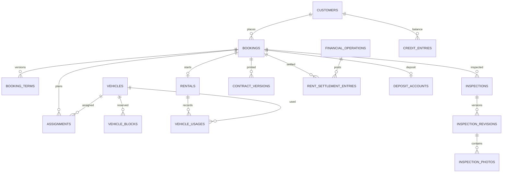

# Проект модели данных

> Бронь хранит плановую стоимость и историю редакций. Оплату и залог можно принять после начала оформления. Подтверждение подписей и поступлений требуется для выдачи. Журнал оплат показывает фактические поступления и возвраты. [Оформление и выдача](stage-6.md).

Обновление бронирования: части ФИО lastName/firstName/middleName хранятся в существующем customers.details JSONB, полное имя — display_name. Отдельная миграция не требуется. Обновление клиента защищается его собственной version и атомарно с сохранением брони. [Текущее поведение](booking-ux-2026-11-14.md).

14 ноября 2026 года пользователь принял этап 4 — бронирования, расписание и шахматку, включая согласованные доработки интерфейса и конфликтов. Этапы 1–4 завершены и приняты. [Результат этапа 4](stage-4.md). Этап 5 — финансовое ядро и оплаты — реализован по последующей команде пользователя 15 ноября 2026 года, проверен и принят пользователем 18 ноября 2026 года с учётом исправления от 17 ноября: [результат](stage-5.md). Этапы 6–11 не начаты. 86 реальных автомобилей уже импортированы по отдельному разрешению: [результат](fleet-import-2026-11-14.md).

Фактически реализовано 28 таблиц, миграции 0000–0011. Семь финансовых таблиц, ограничения неизменяемости и источник начислений описаны в [этапе 5](stage-5.md). Источник схемы — `apps/api/src/db/schema.ts` и SQL-миграции. Добавлены bookings, booking_eligible_models, booking_terms, booking_risks, schedule_blocks; пробег и порог ТО допускают NULL. Финансовые таблицы и таблицы фактических аренд ниже пока проектные.

Досрочный расчёт по новому правилу 13 ноября: `contractDays` — полные использованные сутки (допускается 0), `lateSeconds`/`remainingFullHours` — остаток после них, `lateCandidateRub` — доплата за этот остаток. В JSONB-снимке добавлены `earlyReturn` (исходное окончание, факт возврата, полные сутки/часы), `pricingBasis` (ставка применимого периода для часов), `refundOrCreditIfFullyPaidRub` (уменьшение итога при условии полной предоплаты). Фактические платежи/зачёты этими полями не имитируются; схемы таблиц не меняются.

Уточнение защиты продления 13 ноября: расчётный JSONB-снимок хранит `discounts[]` (fromDay/toDay, amountRub либо bps, reason), чтобы скидка прошлого периода сохранялась независимо от новых условий продления. Снимки прежнего формата читаются со скидкой в границах исходного срока. При продлении прежние строки суток и «Вых» сохраняются; сервер проверяет неизменность их стоимости. Новых таблиц/миграций для этого исправления нет.

13 ноября 2026, этап 3: добавлены `pricing_groups.tariff_code` и `pricing_quotes` (самостоятельный расчёт без booking FK): числовой identity ID, self-FK исходного снимка, авторы/время, version 1→2 при подтверждении, input/snapshot JSONB, подтверждения ручных условий, expires_at. Ставки/периоды/строки суток хранятся в неизменяемом снимке; суммы в JSON — точные десятичные строки, арифметика BigInt. Аудит расширен типом `pricing_quote`. Миграции 0006–0007; остальные таблицы целевой модели Pricing/Bookings/Finance ниже не объявляются реализованными. [Подробности](stage-3.md).

Актуальное изменение: [числовые ID](numeric-ids.md) вместо UUID записей; миграция 0004 сохраняет существующие связи, 0005 вводит отдельные identity-последовательности и тип сущности в аудите, сохраняя ID. UUID requestId остаётся только идентификатором трассировки. [Проверка фактической схемы](schema-review-2026-11-12.md) отделяет реализованные решения от будущей модели ниже.

После разрешения этапа 2 добавлена миграция 0001 с клиентами, заметками, автомобилями и справочниками. Точные таблицы и отличия физической модели (JSONB реквизитов, история в audit_logs) описаны в [stage-2.md](stage-2.md). Ниже — полная целевая модель, включая будущие этапы.

Статус: проект от 12 ноября 2026 года по ТЗ v1.1 и согласованным ответам Q1–Q17, заменяет модель v0.7. Это целевая логическая модель; только таблицы Identity и инфраструктуры этапа 1 уже имеют миграцию, см. [реализованный объём](stage-1.md). Решения и оставшиеся детали перечислены в [реестре уточнений](clarifications-v1.1.md).

## Общие правила

Идентификаторы — UUID. Моменты времени — `timestamptz`, обмен API — ISO 8601 с offset, отображение — Europe/Moscow. Для «Вых» сохраняются номер суток аренды и их 24-часовой интервал от согласованного начала, а не календарный день от полуночи. Интервалы непустые, полуоткрытые `[start_at, end_at)`.

Деньги — bigint в целых рублях, валюта RUB, суффикс полей _rub. В JSON сумма — десятичная строка, например "10000"; дробные денежные значения запрещены. Процентные результаты округляются математически до рубля (половина вверх по модулю). НДС включён в цену: справочное значение = round(total_rub × 5 / 105). Нельзя без проверки преобразовывать bigint в JavaScript Number.

Для изменяемых агрегатов — `version`, `created_at`, `updated_at`; изменения защищены ожидаемой версией. Договорные снимки, денежные операции и результаты завершённых осмотров версионируются или дополняются, но не переписывают историю. Справочники с историей архивируются. Каскадное удаление клиентов/машин с договорами запрещается внешними ключами.

## Связи основного процесса

Диаграмма показывает основные связи; набор таблиц ниже шире. Наличие `rentals` не требуется для осмотра выдачи, предоплаты и печати договора.

## Identity и справочники

| Таблицы | Основные поля и ограничения |
| --- | --- |
| users | full_name, login (уникальный нормализованный), password_hash, role, is_active; первый admin при развёртывании, создание через /users всегда manager |
| sessions | user_id, token_hash, expires_at, revoked_at; cookie содержит случайный секрет, а не роль |
| vehicle_brands | name, normalized_name UNIQUE; отдельная сущность для FK цели брони «марка» |
| vehicle_models | brand_id, name, category, pricing_group_id, archived_at |
| vehicles | model_id, plate_normalized UNIQUE, vin_normalized UNIQUE NULLABLE, year, body_type sedan/hatchback/compact_van/cargo_minibus, current_mileage_km, next_maintenance_due_km, archived_at; кузов не определяет тариф |
| equivalence_groups / equivalence_group_models | Название группы и M:N с моделями; не смешиваются с ценовыми группами |
| customers | type individual/company, display_name NOT NULL, phone?, email?, is_blocked, blocked_reason?, blocked_by?, blocked_at?, version, archived_at |
| customer_identity / company_details | Отдельные защищённые реквизиты физлица/организации, не выдаваемые в поиске календаря |
| customer_documents | customer_id, document_kind, file_id, revision, uploaded_by |
| customer_notes | customer_id, text, is_active, created_by, resolved_by?, timestamps; заметка не является денежным долгом |
| booking_additional_drivers | booking_id, реквизиты ФИО/паспорта/адреса/телефона/ВУ, private file references, version; собственные снимки в версии договора до rentals |

Нормализацию VIN/номера утверждаем отдельно для допустимых форматов; пустой VIN преобразуется в NULL. Минимальный клиент может не иметь телефона/email. Имя не является уникальным ключом и не даёт права автоматически объединять клиентов.

В customer_identity: дата рождения, паспортные серия/номер/орган/дата выдачи, адреса регистрации/фактический, ВУ. В company_details: ИНН/КПП/ОГРН, юридический/почтовый адрес, банк/счета, телефон/факс, представитель и основание полномочий. Email необязателен для отправки фото: без него выдача не блокируется. Обязательность остальных реквизитов задаётся договорным шаблоном. Теги «В аренде», «Есть штраф», «Есть задолженность» — независимые проекции, «Заблокирован» — ручной факт с аудитом. При создании новой брони проверка блокировки и создание выполняются согласованно с командой block/unblock под блокировкой строки клиента.

## Бронь, условия и тарифы

| Таблицы | Основные поля и ограничения |
| --- | --- |
| bookings | customer_id NOT NULL, status, pickup_at, return_at, current_terms_id, version, created_by |
| booking_targets | booking_id UNIQUE, type, vehicle_id?, model_id?, brand_id?, equivalence_group_id?; CHECK ровно один соответствующий типу FK |
| booking_eligible_models | booking_id, model_id; снимок допустимого множества при согласовании цели, UNIQUE пары |
| booking_terms | booking_id, revision, tariff_rate_id?, daily_rate_rub, contract_days, billable_days, daily_mileage_package_km, calculated_mileage_limit_km, mileage_limit_override_km?, effective_mileage_limit_km, base_total_rub, final_total_rub, expected_mileage_km?, snapshot, reason, author; UNIQUE booking+revision |
| pricing_adjustments | terms_id, kind, rental_day_index?, day_start_at?, day_end_at?, amount_rub?, reason, author; «Вых» относится к расчёту и не создаёт разрыв занятости |
| pricing_groups / tariff_plans | Ценовая группа моделей, категория, пакет 100/250/400 км В СУТКИ, scope=per_day |
| tariff_rates | pricing_group_id, tariff_plan_id, диапазон договорной длительности и период действия, daily_price_rub; «Вых» не переводит договор в другой диапазон ставки |
| deposit_rules | category, suggested_amount_rub, effective_from; базовые суммы 10000 и 15000 рублей |
| risk_acknowledgements | booking_id, actor_id, reasons_snapshot, evaluated_at, schedule_revision, accepted_at |

`booking_targets` с отдельными FK предлагается вместо полиморфного `target_id`, который не даёт реляционной проверки ссылки. Снимок допустимых моделей не расширяется автоматически после изменения группы аналогов. Изменение цели брони — отдельная проверяемая операция с новым снимком.

Для ставок запрещаются неоднозначные перекрытия одной группы/пакета одновременно по сроку аренды и периоду действия. Открытые диапазоны: легковые 8+ суток, микроавтобусы 2+ суток. Ставка и условия фиксируются в редакции; изменение справочника не меняет историю.

Цена вычисляется сервером. `calculated_mileage_limit_km = daily_mileage_package_km * max(1, contract_days)`; effective limit — явный override либо рассчитанный лимит. При досрочном возврате до первых суток contract_days=0, но включён минимум один пакет; это не добавляет стоимость полных суток. Явный индивидуальный лимит, в том числе 0, имеет приоритет. Оплачиваемые сутки не подменяют договорные: «Вых» не уменьшает лимит. Например, 250 × 10 = 2500 км, даже при одном «Вых». Расчёт превышения: `max(0, total_usage_mileage_km - effective_mileage_limit_km) * 7` рублей. Ручные цена/лимит/дни подтверждаются с причиной. Первоначальный срок — целые сутки. При досрочном возврате по новому Q6 используются полные сутки, без округления вверх, и одна большая доплата за остаток часов/перепробег. После первого пакета остаток часов не добавляет следующий пакет. При продлении новый тариф применяется только к добавленному периоду. Детали — Q6–Q9.

Опоздание хранится кандидатом расчёта: agreed_return_at snapshot, actual_return_at, full_late_days, remaining_full_hours, late_candidate_rub, mileage_candidate_rub, selected_surcharge_rub, confirmed_surcharge_rub, calculation_rule_version, reason. По ответу Q3 selected = MAX(опоздание, перепробег); начисление одно. Опоздание = полные 24-часовые сутки × ставка + остаток: 0 часов → 0, 1–4 полных часа → 300 ₽ за час, 5–23 → ставка суток. 26 часов = сутки + 600 ₽. Пробег растёт только при отдельном продлении; «Вых» и просрочка сами его не увеличивают. Полная формула — [реестр уточнений](clarifications-v1.1.md).

## План и фактическое использование

| Таблицы | Основные поля и ограничения |
| --- | --- |
| booking_assignments | booking_id, vehicle_id, assigned_at, released_at?, reason; максимум одно текущее назначение на бронь |
| vehicle_blocks | vehicle_id, period tstzrange, assignment_id?, maintenance_id?, preparation_id?, retired_at?; ровно один источник, запрет пересечения действующих плановых блоков |
| booking_checkouts | booking_id UNIQUE, issued_vehicle_id, issued_at, returned_at. При первом нажатии «Завершить аренду» в return_started_at и return_started_by сохраняются время и сотрудник. |
| push_subscriptions | Уникальный endpoint устройства, ключи шифрования, сотрудник и сессия подключения. Для каждого события начала и подписки создаётся отдельное задание rental.push в outbox_jobs. |
| rental_return_revisions | booking_id, revision, inspection, calculation?, reason?, actor_id, created_at |
| vehicle_unavailability | vehicle_id, source, actual_start_at, actual_end_at?, reason; фактический запрет выдачи независимо от будущего плана |
| vehicle_readiness_events | vehicle_id, ready/not_ready, reason, source, author, at; история решения о готовности |
| maintenance_jobs | vehicle_id, kind regular/repair/accident, planned times, actual times, mileage_at_service, status |
| vehicle_preparations / vehicle_issues | Подготовка и неисправности, блокирующий признак, завершение и причина |
| mileage_readings | vehicle_id, source inspection/service/correction, reading, at, actor; исправления аудируются |

Частичный уникальный индекс `one_open_vehicle_usage` обеспечивает одну текущую выдачу на автомобиль. Изменения назначения, выдача, приёмка и неготовность используют единый протокол блокировок расписания. Перед выдачей проверяются одновременно план, отсутствие открытого использования, готовность и обязательные сведения.

`bookings.status` хранит `confirmed`, `cancelled`, `completed` и `completed_early`. Активная аренда определяется выданной записью `booking_checkouts` с пустым `returned_at`. Эта же запись хранит фактический период использования. Миграция 0019 ограничивает одним открытым использованием на автомобиль и сохраняет существующие выдачи. Возврат одновременно закрывает использование, выводит плановое назначение из активного расписания и устанавливает итоговый статус брони.

Таблица `rental_return_revisions` хранит последовательные снимки осмотра, автора, время, причину исправления и, при подтверждении, расчёт. Ответственный за заполнение хранится в `inspection_work` с видом `check_in` по текущей версии брони. Сохранение осмотра проверяет владельца и закрывает работу в транзакции записи редакции. Окончательный расчёт опирается на действующие `booking_terms`. Разница проводится в `finance_charges` с уникальным ключом операции, привязанным к редакции. Платежи и исходные условия сохраняются отдельными записями. Срок `private_files.delete_after` для фото аренды обновляется с фактом возврата. После истечения срока запись об удалении и задание на физическое удаление фиксируются вместе.

Реальная замена согласована: атомарное закрытие использования старой машины и открытие новой с двумя осмотрами, сменой плановых назначений и новой редакцией условий. Цена меняется со следующих суток аренды либо по подтверждённой ручной корректировке. Ошибку записи нельзя исправлять удалением предыдущей выдачи.

Порог ТО хранится явно и редактируется с историей: после ТО предлагается пробег обслуживания + 10000 км, но сотрудник может задать иной порог. При приёмке текущий пробег обновляется из завершённого осмотра атомарно; ручная правка не переписывает прошлые акты. Прогноз использует текущий/ожидаемый пробег и сам по себе не запрещает бронь. Пакет километров — разрешённый лимит, а не доказательство будущего пробега.

## Finance

| Таблицы | Назначение |
| --- | --- |
| payment_expectations | Планируемый способ/сумма и номер счёта организации; не участвует в денежных остатках |
| financial_operations | UUID команды UNIQUE, вид/назначение, method, автор, причина, occurred_at сервером, confirmed_at, reversal_of?, classification_version; единая шапка транзакции |
| external_money_movements | operation_id, direction in/out, purpose, method cash/bank, amount_rub; только реальные внешние деньги |
| cash_funds / cash_fund_entries | Два физических фонда operating_cash/deposit_pool и их signed_amount entries; строки связаны с operation_id и transfer_id? |
| initial_fund_balances | fund UNIQUE, amount, effective_at, entered_by; разовое исходное сальдо до рабочих операций, не поступление |
| cash_reconciliations | operation_id, expected_balance, actual_balance, difference, fund_version, reason; для операционной кассы |
| financial_journal_rows | Проекция операций/движений для единого журнала; перевод резерва в оплату штрафа даёт ровно две связанные строки |
| operation_purposes | Версионируемый серверный каталог допустимых направлений, полей, способов и финансовой классификации; без UI-конструктора |
| rent_settlement_entries | Проекция settlement/перераспределений для покрытия конкретного договора; не второй независимый журнал тех же погашений |
| customer_credit_accounts / credit_entries | Клиентский денежный остаток и неизменяемые движения с booking/source allocation; кэш баланса сверяется с журналом |
| customer_credit_lots | Источник доступного остатка: переплата аренды/размороженный залог, original_operation_id, source_fund/method, остаток; сохраняет происхождение для Q1 |
| deposit_accounts / deposit_entries | Обязательство вернуть залог конкретной брони; не физический остаток deposit_pool |
| fine_reserves | deposit_account_id, booking_id, reserved_amount, remaining_amount, returned_at snapshot, release_at, released_at?, version |
| fines | uin_normalized UNIQUE, violation_at, rental_id, vehicle_id, customer_id, amount, mismatch_acknowledgement?, version |
| manual_debts | customer_id, booking_id?, amount, reason, version; без fine_id и без дубля штрафа |
| receivables / receivable_entries | Единый источник суммы обязательства, тип fine/manual/rent_charge/damage и уникальная ссылка на источник; корректировки и погашения неизменяемыми entries |
| receivable_settlements | operation_id, receivable_id, amount, source allocation; регистрация долга не создаёт денежное поступление |
| financial_allocations | Связь расходования/возврата с исходными суммами; контроль доступного остатка и происхождения средств |

Это операционный денежный журнал CRM, а не полноценная бухгалтерская система. Таблицы детализации связаны с одной financial_operation. Внешний платёж не дублируется в выручке из-за записи распределения. `financial_journal_rows` — read model, а не второе место ручного ввода. У каждой суммы в fines/manual_debts либо единственный владелец, либо явно обозначенный проверяемый snapshot; outstanding и теги считаются из receivables. Для одного штрафа UNIQUE source запрещает второе обязательство.

| Операция | Внешние деньги | Покрытие аренды | Баланс клиента | Залог |
| --- | --- | --- | --- | --- |
| Получено 10000 ₽ за аренду А | +10000 ₽ | А +10000 ₽ | — | — |
| Переплата 2000 ₽ из А оставлена клиенту | 0 | А −2000 ₽ | +2000 ₽ | — |
| Остаток 2000 ₽ использован для аренды Б | 0 | Б +2000 ₽ | −2000 ₽ | — |
| Наличный залог 10000 ₽ | +10000 ₽ с purpose deposit | 0 | 0 | +10000 ₽ |
| Зарезервировано 3000 ₽ на штрафы | 0 | 0 | 0 | Внутри остатка 10000 ₽ выделено 3000 ₽ |
| Возвращено 7000 ₽ залога | −7000 ₽ с purpose deposit | 0 | 0 | Осталось 3000 ₽ резерва |

Использование доступного остатка в покрытии аренды согласовано в BR-CREDIT-01/BR-VIS-01 v1.1. Денежный остаток сам по себе не является оплатой другой аренды: нужна явная операция использования. По ответу Q1 залоговая часть зачёта создаёт перевод −deposit_pool/+operating_cash, арендная переплата уже в кассе повторного поступления не создаёт. Банковское происхождение тоже сохраняется. Таблица выше описывает обязательства и внешние деньги, движения конкретных фондов определяются source allocations.

Остатки считаются по журналу; при хранении кэшированного баланса он обновляется в той же транзакции и сверяется с журналом. Ограничения: amount > 0 для движения; доступный клиентский остаток и резерв не могут стать отрицательными; резерв не больше удерживаемого залога; возврат не больше доступного возвратного источника; одна коррекция не может отменяться дважды. По Q4 физические фонды могут быть отрицательными после явного предупреждения с причиной, поэтому CHECK balance >= 0 для них запрещён. Нулевой залог/нулевой резерв — допустимые условия без фиктивного нулевого платежа.

В действующем журнале расчёт при приёмке переносит удержанную сумму из `deposit` в `credit` с заполненным `finance_allocations.available_at`. Запросы доступного остатка и источников учитывают её с этого момента, через 21 календарный день от фактического возврата по Москве. При исправлении даты две встречные записи в той же операции переносят неиспользованный остаток источника на новый срок. Выплаты и остатки физических фондов от этого не меняются. При компенсации учитываются обе записи.

Замороженный остаток становится доступным через 21 календарный день от фактической приёмки. В целевой модели Транзакция разморозки уменьшает reserve.remaining, добавляет доступный credit lot с прежним происхождением и помечает уникальную операцию release:<id>. Она не меняет физический фонд и не создаёт внешний платёж. Worker и запрос баланса используют один идемпотентный обработчик с блокировкой резерва. При повторной обработке/одновременной оплате высвобождается только ещё не использованная сумма.

Оплата штрафа из залогового резерва атомарно уменьшает reserve/credit lot, погашает receivable, проводит −deposit_pool/+operating_cash и создаёт две связанные строки журнала без external_money_movement. По Q2 до срока разрешён любой штраф того же клиента; на аренду/ущерб/ручной долг/возврат замороженная часть не расходуется. После разморозки все согласованные назначения доступны. Переплата арендного происхождения расходуется без повторного движения кассы по Q1. Оплата внешними деньгами создаёт одно поступление и settlement, но не дополнительное начисление штрафа. Ручной долг погашается деньгами или доступным остатком по Q5.

Внутренние расчёты создают движение выбранного фонда с обязательным свободным комментарием и нулевым влиянием на клиентские счета, выручку и бизнес-расходы. Справочник получателей, их долги и сверка выдачи/возврата отсутствуют. Дефицит обеспечения залогового фонда показывается отдельно от отрицательного физического остатка.

Текущая касса = начальное сальдо + все проведённые движения operating_cash до текущего времени. Периодные итоги используют финансовую классификацию, а не простую сумму положительных/отрицательных строк. Инкассация, перевод, начальное сальдо, недостача и излишек имеют отдельные типы. Экспорт и журнал используют один фильтр/снимок данных; «текущая касса» не ограничивается периодом таблицы.

| Операция | Физический фонд | Обязательство/покрытие | Классификация итогов |
| --- | --- | --- | --- |
| Наличные за аренду | Касса + | Покрытие аренды + | Внешнее поступление аренды |
| Безналичные за аренду | Не меняется | Покрытие аренды + | Внешнее безналичное поступление |
| Получен наличный залог | Залоги + | Обязательство клиенту + | Залог, не выручка |
| Внутренняя выдача/возврат | Выбранный фонд −/+ | Клиентские обязательства не меняются | Внутренние расчёты, не доход/расход |
| Разморозка | Не меняется | Frozen −, available + | Внутренняя смена доступности |
| Зачёт залогового остатка | Залоги −, касса + | Остаток клиента −, выбранный долг − | Перевод, не внешнее поступление |
| Зачёт арендной переплаты | Повторного прихода нет | Остаток клиента −, выбранный долг − | Перераспределение, не внешнее поступление |
| Инкассация | Касса − | Клиентские обязательства не меняются | Инкассация, не расход |
| Фактический ремонт | Касса − при cash; при bank без изменения наличных | Не создаёт клиентский долг | Расход с автомобилем |
| Сверка | Касса ± разница | Клиентские обязательства не меняются | Недостача/излишек отдельно |
| Начальное сальдо | Начальный остаток фонда | Клиентские обязательства не создаются автоматически | Не поступление/расход |

Порядок выдачи блокировок для финансов фиксируется один для API и worker: клиентские счета и исходные резервы/credit lots в стабильном порядке, затем обязательства, затем физические фонды в стабильном порядке. Проверки списания, release и сверки используют этот общий протокол. Начальные физические остатки не подменяют ввод индивидуальных обязательств клиентам при будущем переходе на реальные данные.

Выручка по кассовому определению ТЗ строится по внешним поступлениям аренды минус внешние возвраты, включая возврат клиентского остатка, происходящего из оплаты аренды. Перевод в баланс и его расходование не создают новых денег. Отчёт по отдельной аренде использует распределения, а не повторно считает старое внешнее поступление. Учёт удержанного штрафа и распределение возвратов по периодам нужно согласовать для P1.

Покрытие, долг, переплата, удерживаемый залог и клиентский остаток возвращаются разными полями. `debt = max(0, price - coverage)`; переплата не маскируется отрицательным долгом. Доля для цвета ограничивается 0–100%; при цене 0 используется полное покрытие без создания платежа. Завершённые аренды сохраняют финансовую окраску и обновляют её при оплатах.

Поступление по счёту проводит банковскую операцию `rent_payment` с распределением в аренду и без движения физических фондов. Дата и номер платёжного поручения сохраняются в аудите проводки. Невозвращённый остаток блокирует отмену, перенос и смену назначенной машины уже до начала оформления. Если назначения ещё не было, автомобиль можно назначить впервые.

## Осмотры, версии и инфраструктура

Миграция `0012` добавляет `inspection_revisions`, `inspection_revision_photos`, `private_files`, `contract_versions` и `contract_signing_confirmations`. У редакции осмотра ключ из брони, вида и номера редакции. Фото связывается с редакцией после проверки брони, машины и вида осмотра. Метаданные файла принадлежат либо брони, либо клиенту. У договора есть ссылка на редакцию условий, неизменяемый снимок, идентификатор версии шаблона, состояние генерации и отдельное подтверждение подписи. Дедлайн фото хранится в `private_files.delete_after`. Миграция `0013` добавляет `booking_checkouts` с фактом начала оформления, подтверждением подписи акта по редакции осмотра и фактом выдачи по конкретной машине и версии договора. Миграция `0014` добавляет `inspection_act_versions` и ссылку `booking_checkouts.act_version_id` для новых подтверждений подписи акта; ранее сохранённые подтверждения остаются в истории. Миграция 0015 добавляет nullable-поле vehicles.has_casco. У готовых версий договора и акта хранятся снимок данных и идентификатор шаблона. При замене готового PDF worker удаляет устаревшие байты и переводит их метаданные в deleted. Миграция `0017` добавляет `booking_checkouts.stopped_at`. Прекращённое оформление исключается из текущего статуса и закрывает незавершённый осмотр выдачи. Сохранённые редакции и подписи остаются в истории. При новом старте обновляются дата и автор начала оформления.

Ниже приведена более широкая проектная модель, включающая акт, фактическую аренду, фото-ссылки и следующие этапы.

| Таблицы | Основные поля и ограничения |
| --- | --- |
| inspections | booking_id, vehicle_id, type pickup/check_in, current_revision_id; доступны до rentals |
| inspection_revisions | Неизменяемые сохранённые редакции по брони, виду осмотра и номеру редакции. |
| inspection_work | Миграция `0016`. Один ответственный оператор на бронь и вид осмотра. Запись действует для указанной версии брони и удаляется при сохранении или отмене заполнения. Введённые поля хранятся на устройстве оператора до сохранения. |
| inspection_photos | revision_id, file_id, damage classification, uploaded_by, delete_after?, deleted_at?; фото приёмки не смешиваются с фото выдачи |
| contract_versions | booking_id, revision, terms_id, customer/vehicle snapshots, template_version, file_id?, generation_status |
| inspection_pdf_versions | inspection_revision_id, template_version, file_id?, generation_status |
| files | private object key, size, MIME, checksum, category, status, created_by, delete_after?, deletion_state?, deleted_at? |
| inspection_share_links | booking_id, vehicle_id, inspection_revision_id, token_hash UNIQUE, expires_at, revoked_at; только pickup |
| share_link_photos | link_id, photo_id; явный список разрешённых фото повреждений данной редакции |
| work_sessions | booking_id, user_id, browser_session_id, heartbeat_at, expires_at; по одной строке на вкладку/устройство |
| idempotency_records | actor, operation, key, request_hash, result reference, state, expiry; уникальность комбинации |
| audit_logs | actor, action, entity, reason, changes с маскировкой, request_id, at |
| outbox_jobs / email_attempts | business_key UNIQUE, kind, payload reference, status, attempts, next_attempt_at, lease_until; результат попытки |
| expenses (P0) | financial_operation_id UNIQUE, vehicle_id?, maintenance_job_id?, category repair/parts/maintenance/wash/operating/other, amount, incurred_at; единый источник фактического расхода, общие расходы допустимы без автомобиля |

Задание `booking.accounting-email` хранит ID брони, ID назначения и уникальный ключ на бронь. Обработчик берёт подтверждённую бронь с действующим назначением, указанным в задании. Старая запись без ID назначения требует явной команды оператора. `done` означает принятие письма SMTP-сервером, `failed` — отказ или исчерпание повторов, `unknown` — неопределённый исход без автоматического повтора.

При успехе время фиксируется в `payload.sentAt` в том же обновлении, что и `done`. Для прежних завершённых заданий время определяется по `next_attempt_at` за вычетом минуты, которую добавлял обработчик.

Стоимость ТО не хранится независимо и в maintenance, и в expenses: карточка ТО читает сумму связанных расходов. Иначе аналитика может посчитать ремонт дважды.

В contract_versions добавляются снимки дополнительного водителя, единственного подписанта арендодателя, суточного пакета и лимита, а также разбивка цены по периодам. included_vat_rub = round(final_total_rub × 5 / 105) — справочная строка «в т.ч. НДС 5%»; она не создаёт receivable или financial_operation и не прибавляется к цене.

Индексы: диапазоны vehicle_blocks; даты и статус брони; все используемые FK; нормализованные поля поиска; незакрытые выдачи; журнал операций по клиенту/брони/дате; активные сессии; due-задания по status+next_attempt_at. Индексы добавляются по реальным запросам и EXPLAIN, не на каждое поле.

Проблемы брони — вычисляемая проекция с `evaluated_at`, причинами и актуальными фактами, а не независимый вручную редактируемый статус. Принятие риска хранится отдельно и не скрывает текущую проблему.

## Дополнение: расчётные периоды, подписи и удаление

| Таблица/снимок | Основные поля и ограничения |
| --- | --- |
| pricing_periods | terms_id, sequence, kind initial/extension/replacement, starts_at, ends_at, tariff_duration_days, tariff_rate_snapshot, rate_rub, source_period_id?; последовательные периоды новой редакции |
| pricing_day_lines | terms_id, rental_day_index, start_at, end_at, base_rate_rub, non_billable, adjustment_rub, effective_amount_rub, reason?; UNIQUE terms+day_index |
| calculation_snapshots | booking_id, terms_revision, rule_version, input_versions, operation_kind, old/new amounts and limits, components, warnings, explanation; расчёт не является платёжной записью |
| vehicle_replacements | rental_id, old_usage_id, new_usage_id, at, reason, terms_id, operation_id UNIQUE; связь двух использований без завершения аренды |
| fuel_charge_snapshots | usage_id, pickup_revision_id, return_revision_id, out/in_eighths, tank_liters, unit_price_rub=80, calculated_rub, confirmed_rub, reason?, revision; один исходный receivable на usage, исправления разницей |
| document_signing_confirmations | booking_id, contract_version_id, inspection_pdf_version_id, actor_id, confirmed_at; подтверждение только конкретных версий |
| warning_acknowledgements | operation_id, warning_code, source_revision, actor_id, at; отсутствие фото и внерабочие часы не обходят другие проверки |
| photo_deletion_tasks | rental_id, due_at, state, attempts, lease_until, deleted_at?; UNIQUE rental_id, обработка всех связанных фото и производных файлов |

Уточнение пользователя 13 ноября: ручная цена задаётся за сутки. Период хранит тарифную dailyRateRub, собственную customDailyRateRub и причину; строка суток — baseRateRub, agreedDailyRateRub и сумму после «Вых». Итог — сумма оплачиваемых суток минус скидка. lateDailyRateRub в снимке вычисляется из согласованной цены последних суток, отдельного ручного ввода нет. Старые снимки с итоговой customTotalRub не переписываются; новая редакция требует явно задать суточную цену или вернуться к тарифу. Расчётные снимки сохраняют разбивку, которую читает hint.

В vehicle_usages добавляются pickup_inspection_revision_id, return_inspection_revision_id и tank_liters_snapshot. Значение объёма определяется только AC-65: cargo_minibus → 80, sedan/hatchback/compact_van → 40. Новые типы кузова и произвольные баки не вводятся. Возвратный одометр не меньше выдачного в пределах одной машины; сравнивать одометры разных машин нельзя.

В inspection_revisions.vehicle_snapshot сохраняются VIN, марка, модель, номер, год, кузов, пробег, next_maintenance_due_km и объём бака. Топливо целое 0..8, повреждения или явное no_damage, особые пометки. Подтверждение отсутствия фото не означает no_damage.

Для фото хранятся deletion_state и deleted_at, а не удаляется сама история осмотра. У файла есть явная категория: фото осмотра, документ клиента, договор, акт. Только фото и их производные получают 30-дневный срок. Дедлайн связан с окончательным rentals.returned_at, не с закрытием отдельного usage при замене. Ссылка не может жить дольше файлов.

Проверка блокировки клиента и выдача синхронизированы с block/unblock. Подписания и готовность документов проверяются внутри подтверждающей команды вместе с версиями; печать не выставляет signed автоматически.
